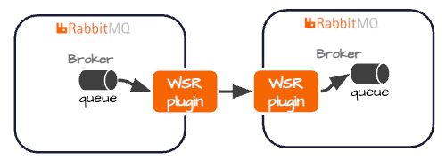

# Warm Standby Disaster Recovery Demonstration

This demonstration showcases Tanzu RabbitMQ Warm Standby Replication for disaster recovery (DR), illustrating how messages are replicated from an upstream broker to a downstream standby broker and how the standby can be promoted when the upstream experiences sustained failures.





## Prerequisites
- [Tanzu RabbitMQ OCI](https://techdocs.broadcom.com/us/en/vmware-tanzu/data-solutions/tanzu-rabbitmq-oci/4-3/tanzu-rabbitmq-oci-image/site-overview.html)
- Podman
- Linux/Bash

## Overview

This demonstration uses the RabbitMQ Warm Standby Plugin to replicate messages from an upstream broker to a downstream broker, which serves as the standby for disaster recovery.

A reference implementation, [check_cluster.sh](../../../../deployment/local/scripts/check_cluster.sh) , monitors the health of the upstream broker. If consecutive health checks indicate a sustained upstream outage, the script initiates promotion of the downstream broker to become the primary.

Note: This is a demonstration implementation, not a complete production-ready disaster recovery solution. Replication is asynchronous, so zero data loss is not guaranteed. Safe failover also requires appropriate fencing of the former primary, client traffic redirection, and verification that the promoted broker is ready to serve traffic.

## Demo Instructions

1. Start Upstream Broker

```shell
PLUGINS="rabbitmq_schema_definition_sync,rabbitmq_standby_replication_delayed_queue,rabbitmq_standby_replication,rabbitmq_jms,rabbitmq_jms_management,rabbitmq_amqp1_0,rabbitmq_shovel,rabbitmq_shovel_management,rabbitmq_stream,rabbitmq_stream_browser,rabbitmq_stream_management,rabbitmq_delayed_queue,rabbitmq_warm_standby,rabbitmq_schema_definition_sync_prometheus,rabbitmq_standby_replication_prometheus,rabbitmq_standby_replication_delayed_queue_prometheus,rabbitmq_web_amqp,rabbitmq_lint_management"

echo "Starting Tanzu RabbitMQ with initial plugins: $PLUGINS..."

podman network create rabbitmq 
podman run -it --rm \
--name tanzu-rabbitmq-upstream --network rabbitmq \
--hostname tanzu-rabbitmq-upstream \
-p 5672:5672 \
-p 5552:5552 \
-p 15672:15672 \
-p 1883:1883 \
-v $(pwd)/docs/DEMO/Local/HA/up/rabbitmq.conf:/etc/rabbitmq/rabbitmq.conf:Z \
  -v $(pwd)/docs/DEMO/Local/HA/up/definitions.json:/etc/rabbitmq/definitions.json:Z \
-e RABBITMQ_ENABLED_PLUGINS="$PLUGINS" \
-e RABBITMQ_SERVER_ADDITIONAL_ERL_ARGS="-rabbitmq_stream advertised_host localhost -rabbitmq_stream advertised_port 5552" \
rabbitmq.packages.broadcom.com/vmware-tanzu-rabbitmq:4.3.0
```

2. Config Upstream Broker with Vhost, Users and Queues

```shell
echo "1. Create dedicated schema vhost"
podman exec -it tanzu-rabbitmq-upstream rabbitmqctl add_vhost  "vhost1" --tags "standby_replication"

podman exec -it tanzu-rabbitmq-upstream rabbitmqctl add_user offsite-replicator "ReplPassword123"

podman exec -it tanzu-rabbitmq-upstream rabbitmqctl set_permissions -p vhost1 offsite-replicator ". *" ". *" ". *"


podman exec -it tanzu-rabbitmq-upstream rabbitmqctl set_permissions -p vhost1 schema-replicator ". *" ". *" ". *"

podman exec -it tanzu-rabbitmq-upstream rabbitmqctl set_permissions -p vhost1 vmware ". *" ". *" ". *"

echo "Check the virtual host tags by running"

podman exec -it tanzu-rabbitmq-upstream  rabbitmqctl list_vhosts name tags

podman exec -it tanzu-rabbitmq-upstream  rabbitmqctl set_policy --vhost "vhost1" osr "^.*" '{"remote-dc-replicate": true}' --apply-to "queues"


curl -i -u vmware:tanzu -H "Content-Type: application/json" \
  -X PUT http://localhost:15672/api/queues/vhost1/q1.quorum \
  -d '{"durable": true, "arguments": {"x-queue-type": "quorum"}}'
  
  
curl -i -u "vmware:tanzu" \
  -H "Content-Type: application/json" \
  -X POST \
  -d '{
    "routing_key": "#",
    "arguments": {}
  }' \
  "http://localhost:15672/api/bindings/vhost1/e/amq.topic/q/q1.quorum"

podman exec -it tanzu-rabbitmq-upstream  rabbitmqctl enable_warm_standby
podman exec -it tanzu-rabbitmq-upstream  rabbitmqctl standby_replication_status
```


3. Start Downstream Broker

```shell
PLUGINS="rabbitmq_schema_definition_sync,rabbitmq_standby_replication_delayed_queue,rabbitmq_standby_replication,rabbitmq_jms,rabbitmq_jms_management,rabbitmq_amqp1_0,rabbitmq_shovel,rabbitmq_shovel_management,rabbitmq_stream,rabbitmq_stream_browser,rabbitmq_stream_management,rabbitmq_delayed_queue,rabbitmq_warm_standby,rabbitmq_standby_replication_prometheus,rabbitmq_schema_definition_sync_prometheus,rabbitmq_standby_replication_delayed_queue_prometheus,rabbitmq_lint_management"

echo "Starting Tanzu RabbitMQ Downstream with plugins..."

podman run -it --rm \
  --name tanzu-rabbitmq-downstream \
  --network rabbitmq \
  --hostname tanzu-rabbitmq-downstream \
  -p 5673:5672 \
  -p 5553:5552 \
  -p 15673:15672 \
  -p 1884:1883 \
  -v $(pwd)/docs/DEMO/Local/HA/down/rabbitmq.conf:/etc/rabbitmq/rabbitmq.conf:Z \
  -e RABBITMQ_ENABLED_PLUGINS="$PLUGINS" \
  -e RABBITMQ_SERVER_ADDITIONAL_ERL_ARGS="-rabbitmq_stream advertised_host localhost -rabbitmq_stream advertised_port 5553" \
  rabbitmq.packages.broadcom.com/vmware-tanzu-rabbitmq:4.3.0
```

4. Publish Messages to Upstream

```shell
for i in {1..100}; do
  curl -i -u vmware:tanzu \
    -H "Content-Type: application/json" \
    -X POST \
    -d '{
      "properties": {
        "content_type": "application/json",
        "delivery_mode": 2
      },
      "routing_key": "account",
      "payload": "Hello, RabbitMQ! Message #'$i'",
      "payload_encoding": "string"
    }' \
    "http://localhost:15672/api/exchanges/vhost1/amq.topic/publish"
done
```

5. Run promotion automation

```shell
./deployment/local/scripts/check_cluster.sh
```

6. Kill Upstream Server


```shell
podman rm -f tanzu-rabbitmq-upstream 
```

7. Verify Failover

Verify automation script output

```text
ACTION: Downstream cluster promotion succeeded (HTTP 204). url: http://localhost:15673/api/tanzu/osr/downstream/promote
```

also open http://localhost:15673/#/standby-promotion/rabbit@tanzu-rabbitmq-downstream

Verify 100 messages failed over


